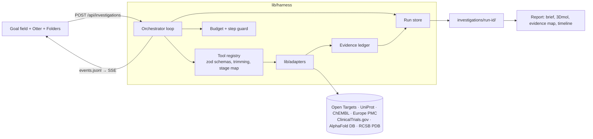

# Design: EvidenceLens

## Architecture

## Key decisions

- **Custom harness on Claude tool use** instead of a general framework: the evidence rules live in code (`lib/harness/ledger.ts`), stage labels come from tool calls, and the guard owns the budget.
- **File-based event stream**: the orchestrator appends to `events.jsonl`; the SSE route tails the file. This survives dev-server module reloads and gives replay for free.
- **Prompt caching**: system prompt and tool definitions are cached; a rolling breakpoint is placed on the newest message.
- **Figures generated in code**: evidence map and timeline are pure SVG functions over the ledger, written at finalize time and reused in the UI. The 3D figure is captured from 3Dmol in the browser.
- **Models**: `claude-sonnet-5-5` for real runs, `claude-haiku-5-5` for plumbing.

## Data model

- `SourceRecord { id, kind, source, title, url, retrievedAt, excerpt, text, identifiers{pmid,pmcid,nct,doi}, year, data }`
- `Finding { id, claim, direction, outcome, kind, sourceIds, supportingPassage, intervention, disease, population, species, endpoint, studyContext, limitations }`
- `Gap { id, description, attempted }`
- `Cluster { id, sourceIds, label }` (union-find over shared identifiers)
- `Brief { title, question, assessment, summary, keyFindings[], opposingEvidence[], contextDifferences[], limitations[], unknowns[], nextQuestions[] }`

## Stages

| Tool | Stage |
| --- | --- |
| update_plan | planning |
| resolve_entities, search_* | searching |
| get_* | reading |
| compare_studies, record_finding, record_gap | comparing |
| finalize_brief | writing |
| (run complete) | finished |
