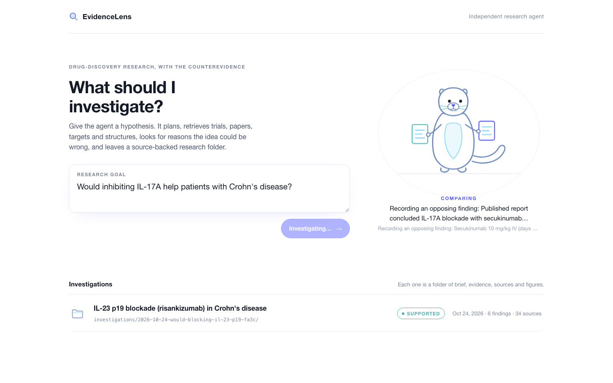
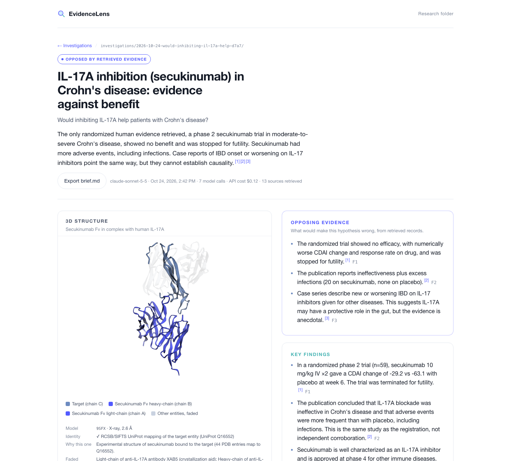
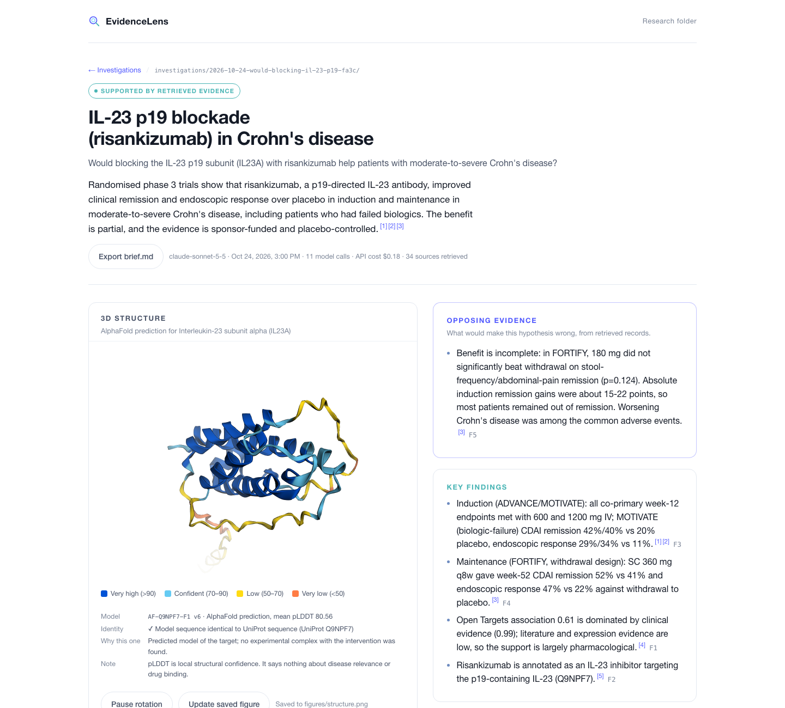
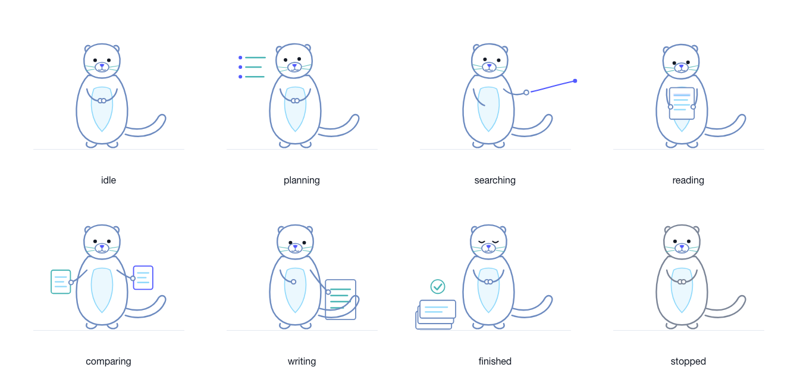
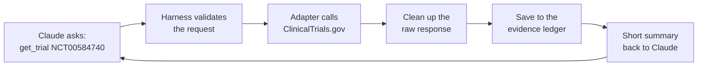
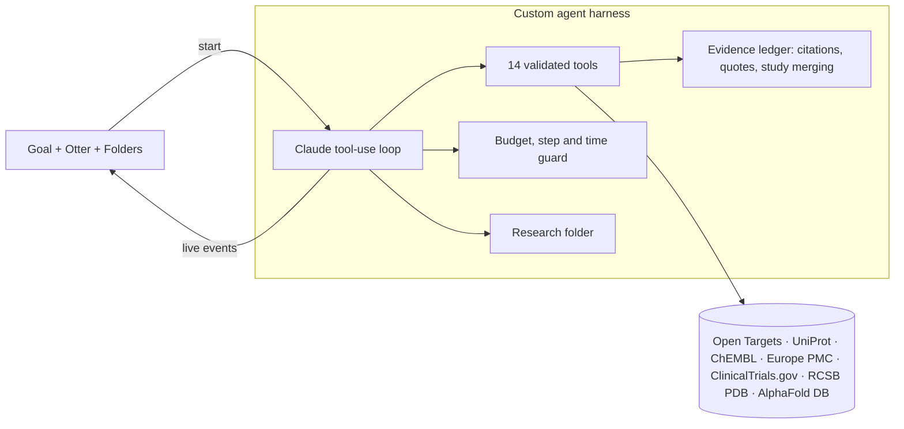

# EvidenceLens

**An AI research agent that checks a drug idea against the world's public scientific record, and looks hardest for the reasons it might fail.**

You type a question like *"Would blocking IL-17A help patients with Crohn's disease?"* About a minute later you have a cited, visual research brief. It gives a clear verdict, shows the evidence for and against, includes a 3D model of the drug on its target, and every claim links to a real record.



---

## In 30 seconds

- **The problem.** About **90% of drugs that enter human trials fail**, and **40–50% of those failures come from the drug simply not working** in patients. A new drug takes **10–15 years and $1–2 billion**. ([Sun et al., 2022](https://pmc.ncbi.nlm.nih.gov/articles/PMC9293739/))
- **The insight.** Much of the evidence that should shape these decisions is already public, but it's scattered across many databases. The most important part, the evidence *against* an idea, is the easiest to miss.
- **What we built.** An independent research agent that searches 7 public scientific databases, builds an evidence ledger, and writes a brief. Its harness won't let it finish until it has searched for counterevidence.
- **What it did today.** We gave it two real historical drug questions. It correctly concluded that one approach **failed in patients** and the other **succeeded**, in **47 and 67 seconds**, for **$0.12 and $0.18** of AI usage.
- **Why you can trust it.** The rules are enforced in code, not left to the AI's goodwill. It can't cite a paper it didn't retrieve, can't misquote one, can't count the same study twice, and can't hide bad news.

---

## Why this matters for drug discovery 

A drug program usually starts with a **hypothesis**: *"If we block protein X, patients with disease Y will get better."* Before spending years and millions testing it, a team wants to know:

1. Is protein X actually linked to disease Y?
2. Does a drug for X already exist, and how far has it got?
3. Has anyone tried this in people? What happened?
4. What do the published papers say, including the ones that disagree?
5. What does the drug physically look like on its target?

Each answer lives in a different database. Each has its own identifiers and its own way of hiding the important detail, such as "this trial was stopped early because the drug wasn't working." Pulling it together by hand means visiting each source, reading registry entries and abstracts, and checking that the IDs line up.

**EvidenceLens does that work autonomously** and hands back something a decision-maker can read in five minutes and audit in fifteen. It speeds up drug discovery in three ways:

- **It kills bad ideas early.** The most expensive failure is one discovered in a phase 3 trial. Surfacing an existing negative trial before a program starts is the cheapest saving there is.
- **It reduces confirmation bias.** The agent is required to search for counterevidence, and opposing findings can't be dropped from the final brief.
- **It leaves an audit trail.** Every claim links to a retrieved record with the exact quote it rests on. A scientist can verify the brief instead of redoing the research.

This is a research-acceleration tool, not a decision-maker. It gives scientists a better starting point.

---

## The proof: two real cases, two opposite answers

We tested the agent on two real, well-documented questions from inflammatory bowel disease (Crohn's disease). Both target the same immune pathway, and history went opposite ways for them.

### Case 1: "Would blocking IL-17A help Crohn's patients?" → **Opposed**



On paper, this looked promising: IL-17A drives inflammation, and the drug secukinumab works well in psoriasis. In 47 seconds the agent:

- found the actual randomized trial (**NCT00584740**) and read that it was **stopped early for futility**, meaning the drug wasn't helping;
- read the published paper (**PMID 22595313**), which reported the drug did **worse than placebo** and caused **more infections**;
- noticed that a second registry entry (**NCT01009281**) is a small **7-patient extension of the same trial**, and counted the trial, the extension and the paper as **one study**, not three. Our own planning notes had listed that extension number as "the trial," and the agent got it right;
- searched for counterevidence and found case reports of IBD appearing in patients taking IL-17 blockers;
- pulled the **real lab-measured 3D structure of secukinumab gripping IL-17A** (PDB 9SFX), verified that the protein chain really is IL-17A, and faded out a helper antibody the scientists had added to make the crystal.

### Case 2: "Would blocking IL-23 (p19) help Crohn's patients?" → **Supported**



Same agent, same rules, opposite conclusion. In 67 seconds it found the **phase 3 ADVANCE, MOTIVATE and FORTIFY** results for risankizumab: patients improved over placebo, including people who had already failed other drugs. It still reported the weak spots. The lower maintenance dose missed one endpoint, and most patients still didn't reach remission.

There is **no lab-measured structure of risankizumab bound to its target**. The agent didn't substitute a structure from another drug; it **said so**, showed the AI-predicted AlphaFold model instead, and colored it by how confident the prediction is.

> Two questions, two different verdicts, both matching the published clinical record. The agent isn't biased toward "yes" or toward "no".

---

## What happens when you press "Begin investigation"

The otter mascot shows **what the agent is actually doing at that moment**. Its pose comes from the tool being run, never from a fake progress bar.



| Otter | What the agent is doing |
| --- | --- |
| **Planning** | Writes a short to-do list (3–6 steps) |
| **Searching** | Looks up the gene, disease and drug; searches trials and papers, **including at least one search for evidence against the idea** |
| **Reading** | Opens the key records in full: a specific trial, a paper, the protein entry, the 3D structure |
| **Comparing** | Records each finding as **supports**, **opposes** or **context**, and records what it looked for but couldn't find |
| **Writing** | Writes the final brief; the harness checks it before accepting |
| **Finished** | The research folder is saved and the result appears on screen |

---

## The 7 scientific databases the agent uses, and why

| Database | In plain words | The question it answers |
| --- | --- | --- |
| **Open Targets** | A map of which genes are linked to which diseases | *Is there any reason to think this gene matters in this disease?* |
| **UniProt** | The encyclopedia of proteins | *What does this protein do in the body?* |
| **ChEMBL** | A catalogue of drugs and drug candidates | *Is there a drug for this target, and how far has it got?* |
| **ClinicalTrials.gov** | The official registry of human trials | *Was it tested in people? How was the trial run, and what happened?* |
| **Europe PMC** | A search engine for millions of research papers | *What did researchers conclude, and who disagrees?* |
| **RCSB PDB** | A library of lab-measured 3D protein shapes | *What does the drug look like bound to its target?* |
| **AlphaFold DB** | A library of AI-predicted protein shapes | *If no lab structure exists, what's the best prediction?* |

Together they cover the path from biology to drug to human results to published conclusions. All seven are free, public and run by major scientific institutions such as EMBL-EBI, the US National Library of Medicine and RCSB.

---

## How the agent uses these databases

**The AI never touches the internet itself.** It can only *ask* to use one of 14 tools. Our code makes the actual web request, checks the answer, and hands back a short summary.

### What happens in one tool call



1. **Claude asks.** For example: use `get_trial` with `{ "nctId": "NCT00584740" }`.
2. **The harness checks the request** against a strict schema. A trial ID must look like `NCT` plus 8 digits, for instance. A malformed request goes back to Claude as an error to fix.
3. **The screen updates.** The status line shows *"Retrieving NCT00584740"* and the otter switches to its reading pose.
4. **An adapter makes the web request.** Each database has one small connector in `lib/adapters/` that sends a standard HTTPS request, with a timeout and retries if the server is busy.
5. **The adapter cleans up the answer.** These databases return large, deeply nested responses. The adapter keeps only the fields that matter and turns them into a standard **source record**: ID, title, link, retrieval time, excerpt, full text and key data.
6. **The record goes into the evidence ledger.** This is the *only* way a source can exist, which is why the AI can't invent one.
7. **Claude gets a trimmed text summary**, capped at about 7,000 characters to keep cost low, and decides what to do next.

None of the seven databases need an API key, and all of them are free.

### What each connector asks for and keeps

| Database | What we ask | What we keep |
| --- | --- | --- |
| **ClinicalTrials.gov** | Search by disease and drug, then fetch one trial by its NCT number | Phase, randomized or not, number of patients, status and *why it stopped*, eligibility, main endpoint, posted results by group (e.g. "drug 26% vs placebo 65%"), side-effect counts, linked papers |
| **Europe PMC** | Papers where every search term appears in the title or abstract, sorted by citations so pivotal studies come first | Title, year, journal, citation count, IDs (PMID, PMCID, DOI), and the full abstract as plain text so quotes can be checked word for word |
| **Open Targets** | A GraphQL query (you list exactly the fields you want): resolve "IL17A" → `ENSG00000112115` and "Crohn disease" → `MONDO_0005011`, then ask how strongly they're linked | Overall link score (0–1) and its breakdown by evidence type, labelled as a **ranking, not a probability** that a drug will work |
| **UniProt** | The protein entry by accession, e.g. `Q16552` | What the protein does, its exact sequence, and for each feature type how many are experimentally confirmed vs only inferred |
| **ChEMBL** | The drug by name, then its mechanism (what it targets and how) and its indications (diseases tested, and how far each got) | Development stage per disease. For example, secukinumab is approved for psoriasis but only reached phase 2 in Crohn's. Code also confirms the drug's target is the same protein being investigated |
| **RCSB PDB** | Every lab-measured structure containing the target protein (44 for IL-17A), then title, resolution and molecule list for each | The structure where one chain is verified as the target and another is named as the drug (for IL-17A: **9SFX**, secukinumab bound to IL-17A). The 3D file is downloaded into the folder |
| **AlphaFold DB** | The AI-predicted model for the target, used when no lab structure with the drug exists | Model link and confidence scores. Used only if its sequence **exactly matches** UniProt's |

### The other seven tools: reasoning, not retrieval

These tools don't make any web request. They're where the harness enforces the rules.

| Tool | What it does |
| --- | --- |
| `update_plan` | Saves the agent's 3–6 step to-do list |
| `resolve_entities` | Turns plain names into database IDs (uses Open Targets and UniProt for lookup only) |
| `compare_studies` | Builds a side-by-side trial table *in code* from records already retrieved |
| `record_finding` | Saves a claim. **Rejected** if it cites a source that wasn't retrieved, or if its quote isn't found word for word |
| `record_gap` | Saves "I looked for this and couldn't find it", kept separate from negative results |
| `finalize_brief` | Submits the report. **Rejected** if there was no counterevidence search, or if any opposing finding is missing |
| `get_target_disease_evidence`, `get_protein`, `get_structure`, `search_compounds`, `search_literature`, `get_publication`, `search_trials`, `get_trial` | The retrieval tools that use the connectors above |

### A real run, step by step (IL-17A, 47 seconds, $0.12)

1. **Plan:** 5 steps.
2. **Open Targets:** IL17A ↔ Crohn's link is weak (0.1).
3. **ChEMBL:** secukinumab inhibits IL-17A; it reached phase 2 in Crohn's.
4. **ClinicalTrials.gov search:** 2 registrations found, the core trial and its extension.
5. **RCSB PDB:** picks 9SFX and downloads the 3D file.
6. **ClinicalTrials.gov detail:** the trial was *"terminated prematurely after futility criterion was met."*
7. **Europe PMC:** the paper reports the drug was ineffective, with more infections than placebo.
8. **Europe PMC counter-search:** case reports of IBD in patients taking IL-17 blockers.
9. **Record and write:** 6 findings and 1 gap recorded, the brief written and checked.

In total that was 18 tool calls from 7 AI replies.

**See the raw data yourself, with no AI and no cost:** `npm run probe -- trial NCT00584740` or `npm run probe -- all`.

---

## What you get: a research folder

Every investigation is saved as a folder anyone can open, share or archive.

**In the app, the report shows:**
1. **Verdict.** Supported, Opposed, Mixed or Insufficient, with a summary and numbered citations.
2. **Opposing evidence, shown first.** The reasons the idea could be wrong.
3. **Key findings,** each with clickable citations.
4. **An interactive 3D structure** you can rotate, plus a saved image for slides.
5. **An evidence map.** Hypothesis → findings → sources, with duplicate records of one study merged into a single node.
6. **A study timeline** showing when each trial ran and each paper was published.
7. **Context, limitations and next research questions.**
8. **The evidence ledger.** Every finding with its exact supporting quote, population, endpoint and study count.
9. **The sources list.** Every cited record, with a link and retrieval time.
10. **An execution trace.** Every tool the agent called, shown only if you expand it.

**On disk:**

```text
investigations/<run-id>/
  brief.md          ← the readable report (exportable)
  brief.json        ← the same, structured
  evidence.json     ← findings, gaps, study clusters, comparisons
  sources.json      ← every record retrieved, with retrieval time
  run.json          ← model, cost, steps, how the run ended
  events.jsonl      ← the full activity log (used for replay)
  figures/          ← structure.png, evidence-map.svg, timeline.svg
  structures/       ← the 3D model file
```

---

## Why you can trust the output: rules enforced in code

Most AI research tools ask the model nicely to be accurate. EvidenceLens's **custom-built agent harness enforces it.** If the AI breaks a rule, its action is rejected and it has to fix it.

| Rule | What it prevents |
| --- | --- |
| Only database connectors can create sources | **Made-up citations** |
| A finding citing an unknown source ID is rejected | **Citing something never read** |
| A quoted passage must appear **word for word** in the retrieved record | **Misquotes and paraphrases presented as quotes** |
| Trial + extension + paper merge into **one study** (shared trial ID, paper ID, DOI or sponsor protocol number) | **Counting the same evidence three times** |
| The brief is refused until a **counterevidence search** has run | **One-sided research** |
| Every opposing finding must appear in the brief | **Hiding bad news** |
| A 3D structure must map to the right protein; nothing unrelated is substituted | **Pretty but wrong pictures** |
| Hard spending limits per run ($1.50) and overall ($12), with a forced wrap-up at 80% | **Runaway cost** |

**It works in practice.** In the two real runs above, the harness **rejected 9 actions**. Several were the AI trying to record a "quote" that wasn't actually in the source. Each time it was sent back, it corrected itself, and the final briefs contain only verified quotes.

---

## Technology

| Layer | What we used | Why |
| --- | --- | --- |
| **AI reasoning** | Anthropic **Claude Sonnet 5.5** (real runs), **Claude Haiku 5.5** (cheap test runs) | Strong tool use; Haiku made development testing almost free |
| **Agent harness** | **Custom-built** in TypeScript on Claude tool use (`lib/harness/`) | So the evidence rules live in code, not only in a prompt |
| **Tool schemas** | **Zod**, auto-converted to tool definitions | Every AI request is validated before anything runs |
| **Cost control** | Prompt caching + a spend ledger computed from real token usage | Each investigation costs cents |
| **App** | **Next.js 16**, **React 19**, server-sent events | The live otter and status line stream from the running agent |
| **3D** | **3Dmol.js** | Interactive structures in the browser, with PNG export |
| **Figures** | Custom SVG generators | The evidence map and timeline are computed from the ledger, not drawn by the AI |
| **Testing** | **Vitest** (52 tests on recorded real API responses), **Playwright** (browser end-to-end and screenshots) | Tests run offline, with no API cost |
| **Development** | **Kiro** | Spec → design → tasks → implementation, one tested commit per task |



---

## By the numbers

| | |
| --- | --- |
| Scientific databases integrated | **7** |
| Agent tools | **14** |
| Time per investigation | **47–67 seconds** |
| AI cost per investigation | **$0.12–$0.18** |
| **Total AI spend for the entire project** (all development, tests and both real runs) | **$0.31** |
| Automated tests | **52**, all passing, plus browser end-to-end tests |
| Records retrieved across the two cases | **47** |
| Rule violations caught and corrected by the harness in real runs | **9** |
| Lines of TypeScript | **~5,700** |

---

## Built with Kiro

The whole project was built in **Kiro** with its spec-driven workflow:

- **Requirements, design and task plan** are in [`.kiro/specs/evidencelens/`](.kiro/specs/evidencelens/).
- **13 tasks**, each implemented, tested and committed separately (see `git log`).
- Each data source was **smoke-tested against the live API** before the agent was allowed to use it. Real responses were saved as test fixtures.
- Real runs uncovered issues, such as how trial registries link extensions to core studies. Each was fixed in the harness with a regression test, then the saved runs were rebuilt.

---

## Try it

```bash
npm install
cp .env.example .env.local     # add ANTHROPIC_API_KEY (used server-side only)
npm run dev                    # http://127.0.0.1:3000
```

- Click an example chip, then **Begin investigation**.
- **Free replay of the saved runs** (no AI calls). The goal types itself in and the agent's real recorded activity plays back:
  - `http://127.0.0.1:3000/?replay=2026-10-24-would-inhibiting-il-17a-help-d7a7&speed=2`
  - `http://127.0.0.1:3000/?replay=2026-10-24-would-blocking-il-23-p19-fa3c&speed=2`
- `npm test` runs the 52 offline tests.
- `npm run probe -- all` checks every database live, with no AI cost.
- `npm run investigate -- --model sonnet "your question"` runs the agent from the command line.
- `/dev-otter` shows all otter poses.

**Security:** this is a local, single-user prototype with no login. Routes that spend money or write files only accept requests from the same machine, and the server binds to 127.0.0.1.

## Honest limitations

- The agent reads abstracts and registry records, not full papers.
- Coverage depends on public APIs and the agent's searches. Missing evidence is recorded as a gap rather than glossed over.
- One agent runs at a time.
- EvidenceLens produces research briefs, not medical advice or treatment recommendations.

---

*Planning history and research notes are in [`docs/`](docs/). Statistics in "In 30 seconds" come from Sun D. et al., "Why 90% of clinical drug development fails and how to improve it?", Acta Pharm Sin B, 2022.*
