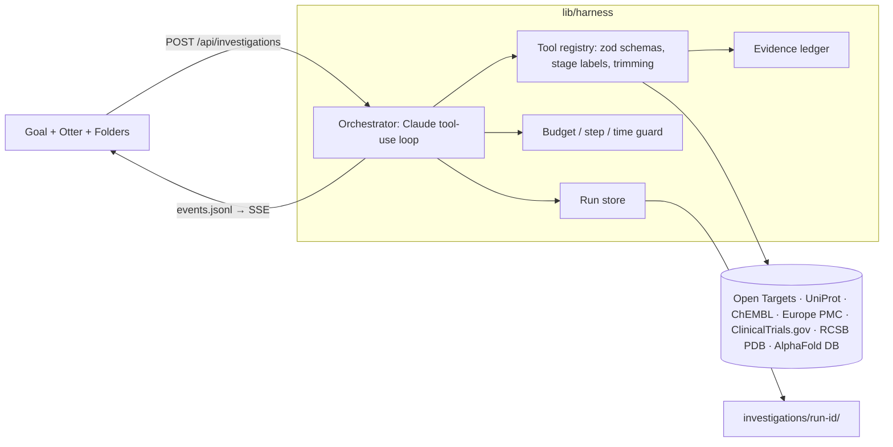

# EvidenceLens

An independent research agent for drug-discovery hypotheses. Give it a question like *"Would inhibiting IL-17A help patients with Crohn's disease?"*. It plans, pulls trials, papers, target evidence and 3D structures from public databases, **actively looks for reasons the idea is wrong**, and leaves a source-backed research folder.

Healthcare & biotech track. Built in Kiro (see `.kiro/specs/evidencelens/`).

## What makes it different

Most "AI scientist" tools rely on the model's prompt for evidence quality. EvidenceLens has a custom harness (`lib/harness/`) that enforces the evidence contract **in code**:

| Rule | Where |
| --- | --- |
| Only adapters create sources; the model can't invent one | `lib/adapters/*`, `EvidenceLedger.register` |
| Findings citing unknown source IDs are rejected | `EvidenceLedger.addFinding` |
| Observations must quote a passage found **verbatim** in the retrieved record | `passageFound` |
| Trial + extension + results paper = **one study**, not three (NCT, PMID, DOI, sponsor protocol ID) | `EvidenceLedger.clusters` |
| The agent **can't finish** until it has run a counterevidence search | `validateBrief` |
| Opposing findings **can't be dropped** from the brief | `validateBrief` |
| Structures must map to the target's UniProt accession; no unrelated molecules substituted | `lib/adapters/structures.ts` |
| Budget: $1.50 per run, $12 overall, forced finalize at 80% | `orchestrator.ts`, `budget.ts` |
| The otter and status line show only the tool actually running | `lib/stage.ts` |



## Saved investigations

| Case | Result | Cost |
| --- | --- | --- |
| `investigations/2026-10-24-would-inhibiting-il-17a-help-d7a7/` IL-17A (secukinumab) in Crohn's | **Opposed.** The RCT NCT00584740 was stopped for futility; the paper PMID 22595313 and the extension NCT01009281 were merged into one study. 3D view: PDB 9SFX, secukinumab Fv bound to IL-17A | $0.12 |
| `investigations/2026-10-24-would-blocking-il-23-p19-fa3c/` IL-23 p19 (risankizumab) in Crohn's | **Supported.** Phase 3 MOTIVATE (NCT03104413), ADVANCE and FORTIFY results. No risankizumab complex exists in PDB, so the view shows an AlphaFold IL23A model colored by pLDDT, with a recorded note that the complex is missing | $0.18 |

Each folder contains `brief.md`, `brief.json`, `evidence.json`, `sources.json`, `run.json`, `events.jsonl`, `figures/` (evidence map, timeline, 3D figure) and `structures/`.

## Run it

```bash
npm install
cp .env.example .env.local     # add ANTHROPIC_API_KEY (server-side only)
npm run dev                    # http://127.0.0.1:3000
```

- `npm test`: 52 unit and integration tests using recorded API fixtures, with no network or model calls.
- `npm run probe -- all`: live smoke test of every source adapter, with no model calls.
- `npm run investigate -- --model sonnet "goal"`: command-line run.
- `npm run rebuild`: re-derive clusters, brief.md and figures for saved runs.
- `/?model=haiku`: cheap plumbing runs from the UI.

**Security:** this is a local, single-user app with no authentication. Routes that spend money or write files only accept requests from localhost, and the dev server binds to 127.0.0.1. Don't expose it on a network as-is.

## Recording the video

Replay mode plays back a saved run through the real UI. It types the goal, presses start, then streams the saved events. It makes no API calls, so retakes are free.

```
http://127.0.0.1:3000/?replay=2026-10-24-would-inhibiting-il-17a-help-d7a7&speed=2
http://127.0.0.1:3000/?replay=2026-10-24-would-blocking-il-23-p19-fa3c&speed=2
```

`speed` scales the real timing (each step stays on screen for 0.65–2.6 s). Speed 4 takes about 26 s. `/dev-otter` shows all eight otter poses.

Suggested 2-minute shot list:
1. **0:00–0:15.** Problem: drug programs fail on evidence that was available but scattered, and opposing data is the easiest to miss.
2. **0:15–0:45.** IL-17A replay: the goal types in, the otter plans, searches, reads NCT00584740 and records opposing findings.
3. **0:45–1:20.** IL-17A report: verdict, opposing-evidence card, rotate 9SFX, hover the evidence map, then the merged "one study" node.
4. **1:20–1:40.** IL-23 report: supported, the same harness reaches the opposite conclusion, and the pLDDT legend explains the predicted model.
5. **1:40–2:00.** Harness rules table, Kiro spec, tests, and about $0.30 total API spend so far.

## Limitations

- Evidence comes from abstracts and registry records, not full texts.
- One agent runs at a time.
- Search coverage depends on public APIs and the agent's queries. Gaps are recorded, not hidden.
- This is a research brief, not clinical advice.

Planning history: [docs/](docs/).
